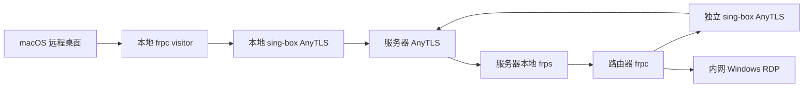

# AnyTLS 远程访问

## 定位与兼容

这是显式安装、开通的可选组件。原来的 `anytls://` 节点格式和 AnyTLS 服务不变；附加组件提供 `stargate://enroll/<base64url JSON>` 一次性开通链接。该格式是 Stargate 应用格式，不是 AnyTLS 协议扩展，也不是通用客户端的订阅格式。

服务端安装入口是 `tools/remote-access/install-server.sh`，可以在已有 AnyTLS 安装后补装。不修改参考 submodule 的安装器，不依赖 `third_party/`。AnyTLS 安装器将来可以调用这个独立入口，但当前尚未内置联动选项。

## 组件与链路

- Linux 服务端：`stargate-remote-controller` 保存设备身份、访客授权和配置版本；`stargate-remote-frps` 提供 STCP 中转。两个服务使用独立非登录用户。
- OpenWrt：`stargate-remote` procd 服务托管独立 sing-box、frpc 和配置同步程序。共用系统 sing-box 二进制，使用单独配置；不更改主 Stargate 的 UCI、DNS、防火墙或出站选择。
- macOS：sing-box、frpc 和同步程序由 `start-macos.sh` 启动，退出时一起停止。本版需要保持启动终端打开。



两端 frpc 都通过专用 SOCKS 连接服务器的 `127.0.0.1:17000`。专用 sing-box 明确将服务器环回目的地经指定 AnyTLS 出站发送；不采用主代理的私网直连规则。只允许控制与 frps 端口，其余连接拒绝，没有直连回退。

## 监听与凭据

默认服务器监听：控制 API `127.0.0.1:17443`（HTTPS），frp 授权插件 `127.0.0.1:17444`（内部 HTTP），frps `127.0.0.1:17000`。不新增公网监听、RDP 映射端口或云安全组放行。

默认客户端监听：SOCKS `127.0.0.1:10830`、HTTP `127.0.0.1:10831`、frpc 管理接口 `127.0.0.1:17400`。映射的客户端入口同样只监听环回地址。上述三个本地服务端口禁止用作映射端口。

控制 HTTPS 与 frp 内层 TLS 使用开通配置内固定信任的独立证书。即使既有 AnyTLS 节点使用 `insecure`，新增控制和 frp 连接仍验证内层服务身份。私密目录 `0700`，凭据文件 `0600`。开通链接包含 AnyTLS 连接凭据和一次性令牌，必须作为秘密保管；不会在普通状态输出或 LuCI 展示。

控制端有独立管理员凭据。设备拥有独立的 publish/bind 能力，可以同时发布和访问；旧 provider/visitor 角色继续兼容。发布者只能修改自己的服务，并只能分配管理员明确授予的访问设备。frps 插件验证设备身份、STCP 类型、名称、密钥和精确访客名单，禁止普通 TCP/UDP 等未授权映射。每设备最多 128 条服务和 128 条本地入口。

## 分离的配置模型

| 对象 | 保存内容 | 管理者 |
| --- | --- | --- |
| Transport | 固定 AnyTLS 节点、控制端地址、TLS 信任 | 开通配置 |
| Service | 发布设备、标识、内网目标、启用状态 | 发布设备 |
| Grant | `发布设备/服务` 与访问设备的授权关系 | 发布设备，受管理员白名单限制 |
| Binding | 本地地址和端口、选定服务、启用状态 | 每台访问设备 |

发布服务不分配访问端口，也不自动创建新设备的入口。不同访问设备可以给同一服务选择不同的本地端口；端口冲突只在同一设备内检查。单个配置目录使用一条固定通道，独立于普通代理的主节点和规则；不提供通道失效后的直连回退。

旧 `anytls://` 不变。开通链接通过 `--new-schema 2` 生成扩展格式，包含固定通道和一次性开通信息；服务端保存的能力与授权是最终依据。旧格式链接、设备身份和 mapping 命令继续接受；旧映射迁移为一条 Service、对应 Grants 和每个访问设备的 Binding，保留已有密钥和端口。迁移本身不增加配置版本。

## 构建与安装

本机构建需要 Go、curl、jq、tar；macOS 下载包使用官方发布文件及仓库固定 SHA-256。构建产物默认存入忽略目录 `.local/remote-build/`。

```sh
sh tools/remote-access/build.sh
sh tools/remote-access/download.sh linux_amd64 .local/remote-build/linux_amd64
sh tools/remote-access/download.sh linux_arm64 .local/remote-build/linux_arm64
sh tools/remote-access/download.sh darwin_arm64 .local/remote-build/darwin_arm64
sh tools/remote-access/download.sh darwin_amd64 .local/remote-build/darwin_amd64
```

服务器首次安装需要私密 AnyTLS 节点 JSON，字段为 `server`、`port`、`password`、可选 `server_name` 和 `insecure`。现有 AnyTLS 必须能访问同一网络命名空间内的环回服务。

把 installer、rollback、`installer-common.sh`、`services/` 与对应二进制传至设备后，在服务器执行：

```sh
sh install-server.sh /path/to/linux_amd64 /path/to/node.json
/usr/local/lib/stargate-remote/stargate-remote admin --dir /etc/stargate-remote \
  enrollment --device mac --role visitor --output /root/mac.link
```

先在访问端兑换 visitor 链接，再签发 provider 链接（它明确授权这个 visitor）：

```sh
/usr/local/lib/stargate-remote/stargate-remote admin --dir /etc/stargate-remote \
  enrollment --device router --role provider --visitors mac --output /root/router.link
```

路由器首次安装：

```sh
sh install-router.sh /path/to/linux_arm64 /path/to/router.link
```

也可以不提供链接先安装组件，服务保持停用，再在 LuCI 导入链接。已有设备身份不会被导入覆盖。

安装器输出部署前备份路径，其中 `rollback.sh` 可以恢复附加组件部署前状态。它们仅管理本组件文件和服务。服务升级会重启附加组件，已有远控会话可能断开；不会升级系统包或 AnyTLS。

升级复用安装入口，不需要重新开通或再次提供节点凭据：

```sh
sh install-server.sh /path/to/new/linux_amd64
sh install-router.sh /path/to/new/linux_arm64
```

安装器先检查候选程序、配置和脚本，再保存备份。升级保留设备身份、授权、映射以及服务原有启用/运行状态，已停用的服务不会临时启动；服务器重新生成 frps 配置，路由器重新生成专用 sing-box/frpc 配置。路由器离线升级保留已存映射，并提示后台重试同步；首次开通仍需服务器可达。本地三个进程启动成功不等于远端 RDP 可达。

安装、回滚、LuCI 增量部署和主代理 sing-box 二进制维护共用 `/var/lock/stargate-remote-install` 互斥锁；路由器备份还等待当前映射更新完成，不保存临时更新锁。正常退出自动释放；异常断电或 SIGKILL 后应确认没有维护进程，再清理遗留锁并重试。

新备份包含组件类型、完成标记、原路径清单、SHA-256 校验和以及独立恢复脚本和共用函数文件。恢复前检查类型、内容完整性、归档成员路径和文件类型；空目录、损坏归档或不同组件的备份都会被拒绝。旧版本生成的备份没有这些标记，新回滚器不会直接接收；旧备份保留其随包恢复脚本，需要恢复时应先核对归档完整性。

首次开通后的链接不能重复兑换。路由器安装器在兑换后保存私密身份恢复副本，成功安装后删除；后续失败回滚时保留打印出的 `/root/stargate-remote-enrollment-*`。重新安装待命组件后，可将其中 `profile.json` 以 `0600` 恢复到 `/etc/stargate-remote/`，再启动通道。LuCI 开通直接保留已兑换身份，失败后可修复并重试启动，不需要再次导入链接。

主代理 LuCI 的 sing-box 升级和回滚也会校验已安装的远控 transport 配置；只重启原本运行的服务，任何受管服务重启失败会恢复原二进制。

macOS 包需包含 `stargate-remote`、`sing-box`、`frpc`、`start-macos.sh` 与 `state/`。首次开通可以提供 `enrollment.link`，或预先兑换并提供 `state/profile.json`。预开通包包含长期访问凭据，应保管在个人设备上。

```sh
sh start-macos.sh
```

## 映射管理

LuCI 的 Stargate → 远程访问页面分为固定通道、发布服务和本地入口，支持导入开通链接、启停组件、编辑/启停/删除服务、调整授权和管理本地入口。页面要求先安装二进制，不自动下载软件。导入时可选同时添加普通 AnyTLS 节点，该选项不会选择主节点。Windows 的地址应稳定，并启用 RDP、允许路由器来源连接；Stargate 不修改 Windows 配置。

已有 LuCI 的实机增量部署使用 `install-luci.sh`，文件包包含 `controller.lua`、`remote.lua`、`remote.htm`、`menu.json`、`remote-control.sh`、`stargate.sh`、`maintenance.sh` 和编译后的 `stargate.zh-cn.lmo`；同时上传 `rollback-luci.sh` 与 `installer-common.sh`。主代理脚本一并更新，以支持私密文件节点导入和共用 sing-box 的维护保护。安装前编译 Lua 和 LuCI 模板，检查菜单入口、备份原文件，失败自动恢复；备份目录内 `rollback.sh` 可恢复部署前界面，不需要重启路由器网络服务。

CLI 示例使用文档网段示例目标：

```sh
# 在发布端，不指定访问端本地端口
stargate-remote service-publish --id desktop --target-ip 10.23.0.10 \
  --target-port 3389 --visitors mac --enabled=true
stargate-remote grant-set --service router/desktop --visitors mac
# 在访问端，端口由该设备自行选择
stargate-remote binding-add --id desktop --service router/desktop \
  --bind-address 127.0.0.1 --bind-port 13389 --enabled=true
stargate-remote binding-delete --id desktop
stargate-remote service-delete --id desktop
stargate-remote status
stargate-remote probe --address 127.0.0.1:13389
```

RDP probe 只验证协商响应，不验证 Windows 登录、画面、音频、剪贴板或实际远控体验。

管理员可动态调整能力，下一次同步生效：

```sh
stargate-remote admin --dir /etc/stargate-remote capabilities \
  --device router --publish=true --bind=true --visitors mac
stargate-remote admin --dir /etc/stargate-remote enrollment \
  --device laptop --role both --new-schema 2 --output /root/laptop.link
```

macOS 图形客户端推荐 Tauri 2：可以将现有 Go、sing-box、frpc 作为 [sidecar](https://v2.tauri.app/develop/sidecar/) 打包，提供托盘、链接导入和本地入口管理；桌面显示由 RDP 客户端承担。本仓库当前提供命令行组件和启动包，尚未实现 Mac GUI 或完成签名、公证。

## 同步与故障语义

默认每 60 秒经 AnyTLS 拉取配置，失败退避至最多 10 分钟；离线保留最后成功配置。设备报告不会增加配置版本。

配置先校验，再替换正式 frpc 文件，然后调用 reload。frpc 的 reload 读取运行进程启动时的正式文件，不能用候选文件参数替代发布。重复映射内容不重复 reload。provider 必须通过本地管理 API 确认所有映射注册为 running，否则恢复上一份配置；visitor 的 configured 仅表示加载配置，连接仍需单独探测。

新增映射采用 frpc 增量更新。修改或删除现有映射可能结束该映射的会话；本版没有通用会话迁移或等待空闲调度。AnyTLS 节点和凭据不参与自动更新，变更与程序升级需要维护操作。

设备撤销拒绝其控制 API；provider 的新工作连接会被拒绝。visitor 撤销需要 provider 同步后的密钥和名单更新生效，已建立流不会被立即强制关闭。不能把这些行为描述为即时清退所有会话。

自动同步范围是远控映射。网站分流规则的自动更新和主 Stargate 规则热加载没有在本模块实现。

## 验证入口

```sh
sh manage.sh check
sh manage.sh check remote
```

本地 remote 检查覆盖开通、并发兑换、设备授权、访客名单、撤销、端口与配额、TLS 固定信任、版本和更新回滚。实机必须另验收实际 AnyTLS 中转、RDP 协商、增量更新以及原有代理回归。源码与示例不能包含部署凭据；私钥、开通链接和设备配置保存在忽略目录 `.local/`。

`tests/installers.sh` 使用 bubblewrap 用户命名空间执行真实脚本，模拟命令失败；需本地 `bwrap`、Lua 和 jq。所有绝对路径位于临时根目录，不操作真实服务器或宿主系统服务。覆盖首次安装、四种服务状态升级、离线、候选损坏、部分进程失败、无效备份、并发维护、回滚和共用 sing-box 升级。
