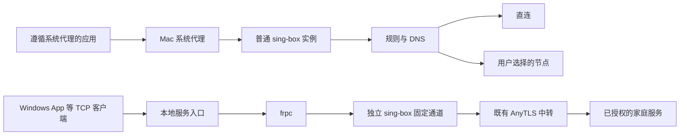

# Stargate for Mac 设计

Status: Design / Not Implemented。2026-10-03。交互原型在本目录，当前真实产品仍是 OpenWrt 管理端与独立远程访问 CLI。下述是完整 Mac 代理应用的实现设计，不是已完成能力。

## 产品范围

Mac 上独立运行的日常代理应用：不依赖用户先配置 OpenWrt，不需要打开终端维持进程。主线是导入节点、连接、设置系统代理、按规则上网与遇错恢复；远程访问为第二条独立能力线，可在普通代理关闭时继续访问家里的 Windows。AnyTLS 作为近期实际使用的协议优先打磨；数据模型预留协议字段，第一版不承诺多协议导入。

使用 sing-box 作为唯一普通代理核心。远控沿用已有 stargate-remote + frpc + 独立 sing-box 通道，不复制 third_party 的代码，也不管理 NetBird、OpenClash 等其他软件。完整产品路线包含 TUN；第一个可交付版本是系统代理版本，TUN 必须在 Mac 上独立验证后开放。

## 布局与交互

默认 1180–1380 px 宽的 Mac 窗口：左侧工作空间，右侧内容。浅灰侧栏、白色卡片、单一蓝色强调。连接主动作只表示普通代理启停，远控卡片和菜单栏均有自己的开关。普通代理模式和系统代理是两个控件：前者控制流量进入核心后如何分流，后者决定遵循系统设置的应用是否把流量送进来。

| 页面 | 信息与操作 |
| --- | --- |
| 概览 | 普通代理连接、当前节点、出口检测、速率、系统代理、规则/全局/直连、远控摘要 |
| 节点 | 导入、解析预览、分组、握手延迟、出口请求、选用、编辑、删除、导出；订阅后续单独实现 |
| 分流规则 | 用户域名/IP、直连/代理/拒绝、基础规则集、DNS 策略、匹配解释、模式切换 |
| 远程访问 | 固定通道、授权服务、这台 Mac 的本地入口、可选发布能力、单独诊断、桌面启动入口 |
| 连接 | 目标、协议、命中规则、出口、流量、筛选；无法获取应用归属时显示未知 |
| 诊断 | 配置/进程/端口/握手/出口/系统代理/远控分层检查、脱敏日志、诊断导出、恢复 |
| 设置 | 外观、登录启动、菜单栏、本地端口、DNS、更新、凭据、系统代理恢复、后续 TUN 授权 |

菜单栏显示代理和远控两条状态，提供连接、系统代理开关、模式、节点、常用远控入口、打开窗口和完整退出。关闭窗口保留后台；完整退出先恢复系统代理再停止受管进程，不能只把窗口藏起来。快捷键包括 Cmd+1…7 切页、Cmd+I 导入、Esc 关闭对话框，正式版采用 macOS 原生菜单注册；浏览器原型保留基础键盘导航与对话框焦点。

首次启动保持未连接、未接管网络。只有导入节点不会直接接管。首次点击连接启动本地入口，明确选择是否开启系统代理；以后记住用户选择。示例原型为便于审视布局，默认展示连接状态。

## 两条数据面

普通代理建议沿用本机 SOCKS 10808、HTTP 10809；远控使用 SOCKS 10830、HTTP 10831、frpc 管理 17400，只有环回监听。所有端口统一预检冲突，允许用户改普通代理端口；远控更改要重新生成并校验相应配置。普通节点切换只重配普通实例，不能 reload/kill 远控实例。

「停止普通代理」恢复系统代理并停止普通核心；远控按自己的开关保留。「仅直连」仍可运行本地核心，不等于退出程序。远控故障无直连回退，也不会偷偷切成当前上网节点。远控每个设备独立保存 Binding，发布设备不决定所有访问设备的端口。

AnyTLS 当前不能据此承诺完整 UDP 转发。系统代理不覆盖忽略代理设置的应用，也不意味着所有 DNS、IPv6 或 UDP 已经受管。UI 检测明确展示覆盖范围。IPv6 TCP 若经 HTTP/SOCKS 到远端需实测；未进入系统代理的 IPv6 保持系统路径。未来 TUN 版另行决定 IPv6、DNS、QUIC、UDP 的代理/拒绝策略，不默认放行未经支持的流量。

## 实现架构

建议 Tauri 2 + 轻量 Web UI 负责窗口、菜单栏、链接导入；Rust 主进程负责类型化命令、配置、单实例、进程监督、日志和更新。现有 Go stargate-remote、sing-box、frpc 作为签名的 sidecar。Tauri 文档明确提供按目标架构打包外部二进制和托盘、deep-link 能力；这能复用当前 CLI，并保持主代理和远控生命周期独立。

第一版可从当前原型的样式与信息结构迁移。避免为复用页面引入 OpenWrt UCI/LuCI 运行依赖，生成 Mac 自己的结构化配置。普通代理与远控监督器分别维护状态机，界面只通过白名单的类型化 IPC 接口控制；不向 WebView 暴露任意命令执行、任意路径读取或管理员令牌。

| 层 | 职责 |
| --- | --- |
| UI | 用户设置、动作、状态订阅、错误解释；不直接持有长期密码 |
| Mac 主进程 | NodeStore、ProfileStore、RuleStore、配置生成、CoreSupervisor、RemoteSupervisor、UpdateManager |
| macOS 集成 | Keychain、系统代理快照/设置/恢复、登录项、睡眠唤醒、网络服务变化 |
| 运行程序 | 普通 sing-box；独立远控 sing-box + frpc + stargate-remote |
| 后续 TUN | 原生 Network Extension、适配核心/隧道生命周期，另做技术验证 |

系统代理优先通过原生 macOS SystemConfiguration 接口与受限辅助组件实现；是否需提权以及签名 helper 的注册形式在目标 macOS 上验证。不要以 GUI 整体 root 运行，也不要用字符串拼 shell 执行网络命令。sing-box 自带 set_system_proxy 可以设置/清理，但正式应用应由 ProxyLease 管理原值、所有权和异常恢复，配置里不同时开启第二套自动接管。

TUN 的长期路径建议原生 NEPacketTunnelProvider；它不是给 CLI 增加 tun JSON 就自动成为签名的 Mac VPN 产品。需要验证 libbox 或等效核心接入、entitlements、扩展签名与分发、DNS/路由排除、物理出口防环以及 VPN 共存。不要把 Linux auto_redirect/nft 规则搬到 Mac。这个阶段对外状态为「尚未实现」，不能放一个看似生效的开关。

## 配置与凭据

正式安装后的配置位于 `~/Library/Application Support/Stargate/`，日志在 `~/Library/Logs/Stargate/`；`.local/` 只用于这个仓库的个人开发资料。目录 0700，运行时含密码的配置 0600。macOS Keychain 保存节点密码、远控 token 等长期秘密；Profile/Node/Binding 用稳定 ID 引用秘密，而不是在 UI store 或 localStorage 保存真实链接。

现有 CLI 需要私密配置文件，因此主进程在启动/重配时从 Keychain 生成最少必要 runtime 文件，检查路径/权限后调用程序；退出按恢复需求清理，不宣称所有秘密从不落盘。设备身份迁移需先完整验证原包，再导入钥匙串。运行配置不得进入普通备份、错误消息或遥测。

个人凭据仅保存在被 Git 忽略的 `.local/secure/`，按设备分类。原型不读取这些资料。公共安装包不预置个人长期身份；现有个人预开通 CLI 包与未来通用安装包分开。

普通 anytls:// 导入：解析 → 脱敏预览 → 用户保存 → 校验 → 可选连接。stargate:// 导入：预览发布者/通道/设备能力 → 用户兑换 → 私密保存 → 启动固定通道 → 拉取授权服务 → 用户选择本地入口。可选同时添加普通节点但不自动选用。兑换后失败仍保存身份供恢复，不能丢弃凭据后要求重用一次性链接。历史已兑换链接只用于记录，不伪装成新开通码。

## 稳定性与恢复

连接状态采用 stopped → validating → starting → ready → stopping；异常为 failed/recovering。UI 的开关显示实际状态而不是点击后的期望值。先验证候选配置，启动本地监听并检查健康，再设置系统代理；失败恢复旧配置，保留可读错误。重配影响现有连接时明确说明，第一版不承诺所有节点切换无损。

系统代理是独立的 ProxyLease：按网络服务 ID 保存原始 HTTP/HTTPS/SOCKS/PAC/例外域设置与本应用实际写入值。恢复前比较当前值与自己的写入值；用户或其他应用已修改时停止覆盖，并提供差异与「恢复原设置」动作。停止、崩溃、升级和开机恢复均复用同一事务账本。独立监督/恢复辅助进程不依赖已崩溃的 UI 来恢复；网络服务变化、Wi-Fi 切换和睡眠唤醒要重新验证租约。不能依赖单个 exit handler 来保证异常恢复。

同一用户只启动一个实例。侧车由本应用记录 PID、启动标识和配置路径，退出只停止自己的实例。远控 watch 跟随独立监督器，不受普通节点重配影响。未知 VPN/代理存在时展示共存状态和检测结果，不主动停其他软件。

分流优先级：内网/保留目标保护 → 用户规则（冲突显式校验）→ 基础规则 → 模式兜底。DNS 与路由使用同一策略编译结果；代理节点域名自举不允许依赖自身代理 DNS 形成循环。规则更新先下载、校验并生成候选配置，成功应用后才提交版本。未知域名仅能给出「待解析」，连接详情展示真实命中和出口。

升级先校验签名/哈希、备份配置与版本、停止受影响实例、验证新核心兼容、切换、健康检查，失败回滚。只升级普通核心时不无故重启远控，但共用程序版本的兼容性需要一起检查。诊断分开显示配置有效、进程启动、节点握手、出口 HTTP、系统代理生效、RDP 协商、桌面登录；不能用端口打开代替完整链路通过。

## 交付顺序与验收

| 阶段 | 可交付内容 | 退出标准 |
| --- | --- | --- |
| 0 · 当前 | 本地七页交互原型、浅/深色、设计文件 | 页面与关键流程可审视；无真实网络操作；示例与当前产品能力区分 |
| 1 · 本地代理 | Mac `.app`、节点导入、HTTP/SOCKS、系统代理、Keychain、菜单栏、恢复账本、分层诊断 | Apple Silicon 与 Intel 真机连接/断开/异常退出均不留下失效代理；登录启动与睡眠恢复通过 |
| 2 · 日常可用 | 域名/IP/DNS 分流、连接解释、规则更新、完整远控 UI、服务端授权与本地入口管理 | 更换普通节点不中断独立远控；远控失败不损坏上网；真实 Windows 登录、画面、剪贴板完成 |
| 3 · 正式发布 | 两架构签名、公证、DMG、更新回滚、非敏感配置导出 | 干净 Mac 安装/卸载、升级失败恢复、日志脱敏与权限通过 |
| 4 · TUN | 已验证的原生隧道与明确 IPv6/DNS/UDP 策略 | VPN 共存、出口防环、断线/网络变化恢复、系统权限与隧道清理通过，再开放控件 |

优先完成一个稳定的系统代理应用，不把订阅、多协议和 TUN 的承诺塞进第一版时间表。完整设计覆盖这些扩展；近期开发仍聚焦已有 AnyTLS 实际场景。当前 WSL 可验证 Web 原型与跨编译侧车，不能代替 Mac 系统集成、签名、公证和实际权限验收。

## 参考资料

技术选择依据以下官方文档；实现时以固定的 sing-box 版本为准，不能把最新文档的新字段直接写入现有 1.12.25 配置。

- [Tauri 外部程序打包](https://v2.tauri.app/develop/sidecar/)
- [Tauri 菜单栏](https://v2.tauri.app/learn/system-tray/)
- [Tauri Deep Linking](https://v2.tauri.app/plugin/deep-linking/)
- [Apple SystemConfiguration / SCPreferences](https://developer.apple.com/documentation/systemconfiguration/scpreferences)
- [Apple Keychain services](https://developer.apple.com/documentation/security/keychain-services)
- [Apple NEPacketTunnelProvider](https://developer.apple.com/documentation/networkextension/nepackettunnelprovider)
- [sing-box Mixed 入站与系统代理](https://sing-box.sagernet.org/configuration/inbound/mixed/)
- [sing-box TUN 平台与版本边界](https://sing-box.sagernet.org/configuration/inbound/tun/)
